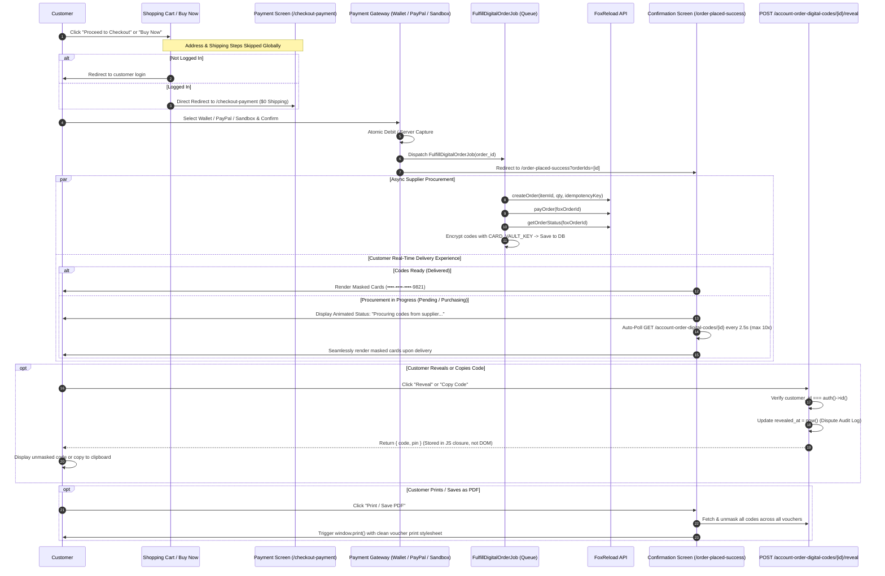

# Digital Checkout Streamlining & Instant Card Delivery Plan

## 1. Executive Summary

This plan outlines the architecture, UX, and code modifications required to convert the store from a physical/hybrid checkout flow into a **100% streamlined digital gift card procurement and delivery experience**.

### Confirmed Design Decisions & Architectural Refinements
1. **Shipping & Address Removal**: Permanently and globally remove all shipping, billing address, and courier steps across the entire website. The shopping cart and "Buy Now" proceed directly to payment with `$0.00` shipping cost.
2. **Customer Auth Guard**: Digital cards require customer accounts for code ownership and auditability. Guest checkouts attempting to reach payment are cleanly redirected to login.
3. **Null-Safe Address Handling**: Synthesize virtual digital address metadata in `OrderManager::generateOrder()` from the authenticated user profile so invoices, order emails, and admin views never encounter `null` pointer exceptions.
4. **Post-Payment Landing**: Replace generic order list redirects (`account-oder`) with a **Dedicated Order Confirmation & Instant Card Delivery screen** (`/order-placed-success?orderIds=...`), backed by resilient session fallbacks.
5. **Security & Audit Trail (Zero Plaintext in DOM)**:
   - Initial HTML renders **only masked strings** (`••••-••••-••••-9821`) without any `data-raw-code` attribute in the DOM.
   - An authenticated endpoint (`POST /account-order-digital-codes/{codeId}/reveal`) verifies ownership, timestamps `revealed_at` for dispute tracking, and returns the decrypted code.
   - Decrypted codes are held only in JavaScript closure variables.
   - "Print / Save PDF" auto-reveals all codes before calling `window.print()`.
6. **Complete Asynchronous Polling State Machine**:
   - Polling triggers when any item is in `pending` or `purchasing` state.
   - Handles `delivered` (unmasks vouchers), `supplier_failed` (shows automatic wallet refund notice), and timeout (after 25s alerts customer that codes will appear in dashboard shortly).

---

## 2. Architecture & Flow Diagram



---

## 3. Detailed Implementation Steps

### Phase 1 — Physical Shipping & Address Removal + Auth Guard

1. **Enforce Customer Authentication on Checkout**:
   - In `WebController::checkout_payment()`, if `!auth('customer')->check()`, redirect to login with toast message.
   - In `custom.js`, verify customer authentication before navigating to checkout.
2. **Global Shipping Bypass**:
   - In `WebController::checkout_details()`, immediately issue a `302` redirect to `route('checkout-payment')`.
   - In `WebController::checkout_payment()`, remove the address validation guard `if (!session('address_id') && !session('billing_address_id'))`.
3. **Streamline "Proceed to Checkout" and "Buy Now"**:
   - In `public/assets/front-end/js/custom.js`:
     - In `checkoutFromCartList()`, route destination directly to `route('checkout-payment')`.
     - In `addToCart()` / `buy_now()`, update redirect target to `route('checkout-payment')`.
4. **Order Summary & Checkout Progress UI**:
   - In `_order-summary.blade.php`: remove shipping cost line; replace with *"Digital Delivery: FREE ($0.00)"*. Direct checkout button to `checkout-payment`.
   - In `_checkout-steps.blade.php`: simplify from 3-step to 2-step progress bar (1. Cart &rarr; 2. Payment).
5. **Null-Safe Address Handling in `OrderManager`**:
   - In `OrderManager::generateOrder()`, when `address_id` is null, build virtual digital address data from `auth('customer')->user()`:
     ```php
     $digitalAddress = [
         'contact_person_name' => $user->f_name . ' ' . $user->l_name,
         'address_type' => 'digital',
         'address' => 'Digital Delivery',
         'city' => 'Digital',
         'zip' => '00000',
         'country' => 'Global',
         'phone' => $user->phone ?? 'N/A',
         'email' => $user->email,
     ];
     ```
   - Stores clean JSON in `shipping_address_data` and `billing_address_data`, ensuring invoice generators, email builders, and admin detail pages never encounter null property exceptions.
   - Ensure `shipping_cost = 0`, `shipping_method_id = 0`, and `delivery_type = 'digital'`.
   - In `OrderManager::checkValidationForCheckoutPages()`, disable physical courier and shipping method checks.

---

### Phase 2 — Post-Payment Redirection & Resilient Parameter Handling

1. **Resilient `orderIds` Parsing in `WebController::getOrderPlaceView()`**:
   - Support JSON arrays (`?orderIds=[1,2]`), comma-separated strings (`?orderIds=1,2`), single integers (`?orderIds=1`), and session fallback (`session('recent_order_ids')`).
   - Query orders with `Order::with(['details.product', 'details.digitalCardCodes'])->whereIn('id', $orderIds)->where('customer_id', auth('customer')->id())->get();`.
2. **Unified Post-Payment Redirects**:
   - `WebController::checkout_complete_wallet()`: store `session(['recent_order_ids' => $order_ids])` and redirect to `order-placed-success`.
   - `PaymentController::web_payment_success()`: store `session(['recent_order_ids' => $orderIds])` and redirect to `order-placed-success`.
   - `SandboxPaymentController::payment()`: store `session(['recent_order_ids' => $orderIds])` and redirect to `order-placed-success`.

---

### Phase 3 — Secure Card Code Reveal & Audit Endpoint

1. **Endpoint `POST /account-order-digital-codes/{codeId}/reveal`**:
   - Controller: `DigitalProductDownloadController::revealCardCode(int $codeId)`
   - Route: Registered in `routes/web/routes.php` under `customer` middleware.
   - Validation & Security:
     - Check `auth('customer')->check()`.
     - Find `DigitalCardCode` by ID; verify `$cardCode->order->customer_id === auth('customer')->id()`.
   - Audit Trail:
     - If `$cardCode->revealed_at === null`, record `$cardCode->update(['revealed_at' => now()])`.
   - Return: `response()->json(['status' => 1, 'code' => $cardCode->card_code, 'pin' => $cardCode->pin])`.
2. **Endpoint `GET /account-order-digital-codes/{orderId}`**:
   - Controller: `DigitalProductDownloadController::getDigitalCardCodes(int $orderId)`
   - Checks ownership, returns order fulfillment status and items with **masked** codes for polling.

---

### Phase 4 — Order Confirmation UI with Masked Vouchers & Complete Polling

1. **Redesign `resources/themes/default/web-views/checkout/complete.blade.php`**:
   - **Hero Order Receipt**: Order #, Date, Amount, Payment Method, Status Badge.
   - **Masked Digital Vouchers**:
     - Product thumbnail, Title, Variant/Denomination badge.
     - **Masked display**: `••••-••••-••••-9821` (never rendering plaintext in HTML).
     - **Reveal button**: Fetches from `/reveal` endpoint once, stores in JS closure, unmasks/re-masks.
     - **1-Click Copy button**: Copies full code to clipboard with "Copied!" tooltip.
     - **PIN field** (if present): Masked with separate Reveal/Copy buttons.
   - **Complete Auto-Polling State Machine**:
     - Activates when order or any item is in `pending` or `purchasing`.
     - Polls `GET /account-order-digital-codes/{orderId}` every 2.5s (max 10 attempts).
     - **On `delivered` / `partially_delivered`**: Replaces loader with vouchers dynamically.
     - **On `supplier_failed`**: Stops polling; displays alert banner: *"Unable to procure this card from the supplier. Your payment has been automatically refunded to your Wallet."* with a direct "View Wallet" button.
     - **On Timeout (25s)**: Stops polling; displays notice: *"Your order is taking a little longer than usual to finalize. Your codes will appear in My Orders shortly and we will notify you by email."*
   - **Print / Save as PDF**:
     - JS triggers pre-print fetch of all vouchers on page before running `window.print()`, so printed vouchers contain unmasked codes.
     - Includes print CSS hiding page navigation and headers.

---

### Phase 5 — Customer Account Order Details Integration

1. **Update `resources/themes/default/web-views/users-profile/account-order-details.blade.php`**:
   - For items with `digitalCardCodes`, replace the old file download button with the same interactive **Masked Digital Voucher** component.
   - Customers can reveal and copy codes anytime from their permanent account history.

---

## 4. File Modification Matrix

| # | File Path | Scope of Changes |
|---|-----------|------------------|
| 1 | `routes/web/routes.php` | Add `POST /account-order-digital-codes/{codeId}/reveal` and ensure `GET /account-order-digital-codes/{id}` is registered. |
| 2 | `app/Http/Controllers/Web/DigitalProductDownloadController.php` | Implement `revealCardCode($codeId)` with audit timestamping and `getDigitalCardCodes($orderId)`. |
| 3 | `app/Http/Controllers/Web/WebController.php` | Redirect `checkout_details` &rarr; `checkout-payment`, remove address requirement in `checkout_payment`, enforce auth guard, add resilient `orderIds` parsing in `getOrderPlaceView`. |
| 4 | `app/Http/Controllers/Customer/PaymentController.php` | Redirect `web_payment_success` to `order-placed-success` with session backup. |
| 5 | `app/Http/Controllers/Payment_Methods/SandboxPaymentController.php` | Redirect sandbox payment completion to `order-placed-success` with session backup. |
| 6 | `app/Utils/OrderManager.php` | Synthesize digital virtual address in `generateOrder()`; bypass courier validations in `checkValidationForCheckoutPages()`. |
| 7 | `resources/themes/default/web-views/checkout/complete.blade.php` | Modern digital card confirmation screen, masked codes, reveal toggle, 1-click copy, print handler, and complete auto-polling. |
| 8 | `resources/themes/default/web-views/partials/_checkout-steps.blade.php` | 2-step checkout progress indicator (Cart &rarr; Payment). |
| 9 | `resources/themes/default/web-views/partials/_order-summary.blade.php` | Remove physical shipping fees, direct checkout button to `checkout-payment`. |
| 10 | `resources/themes/default/web-views/users-profile/account-order-details.blade.php` | Embed masked digital vouchers with reveal and copy in account order details. |
| 11 | `public/assets/front-end/js/custom.js` | Direct cart and "Buy Now" to `checkout-payment`; reveal and copy-to-clipboard handlers. |
| 12 | `cvv6_production_patch/` | Synchronize all modified files and deployment scripts. |
